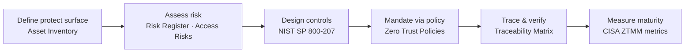

# SecureBank Digital — Zero Trust Architecture Implementation

**Overview** · [Asset Inventory](Asset-Inventory.md) · [Risk Register](Risk-Register.md) · [Access Risks](Access-Risks.md) · [Zero Trust Controls](Zero-Trust-Controls.md) · [Zero Trust Policies](Zero-Trust-Policies.md) · [Traceability Matrix](Traceability-Matrix.md) · [Maturity Metrics](Zero-Trust-Maturity-Metrics.md)

---

## Short Description
A Zero Trust architecture case study for a mobile-first challenger bank. It assesses the existing perimeter-based model, inventories the protect surface, scores 10 risks, designs 12 identity-centric controls under NIST SP 800-207, sets four governing policies, and defines metrics to measure Zero Trust maturity.

    

## Organisation Context

| Attribute | Detail |
|---|---|
| Organisation | SecureBank Digital (fictional) |
| Sector | Digital banking — mobile-first challenger bank |
| Headquarters | Charlotte, North Carolina |
| Size | 750 employees · 500K+ customers across the US |
| Trigger | High-profile breaches at competitor institutions and FFIEC guidance on authentication; board mandate for a Zero Trust transformation |
| Role | Security Architect |

## Objective
Move SecureBank from perimeter-based trust to an identity-centric Zero Trust model in which every access request is verified explicitly, granted with least privilege and continuously evaluated — with measurable progress reported to the board.

## Scope
- Assess the current perimeter-based security model and its risks
- Design identity-centric access controls using NIST SP 800-207 principles
- Implement microsegmentation for the core banking platform
- Deploy continuous verification mechanisms (device posture, session risk, token revocation)
- Establish metrics to measure Zero Trust maturity

## Approach



## Repository Contents

| Document | What it contains |
|---|---|
| [Asset Inventory](Asset-Inventory.md) | 6 protect-surface assets with type, classification, owner and environment |
| [Risk Register](Risk-Register.md) | 5 enterprise risks from the perimeter model, scored L × I with rationale |
| [Access Risks](Access-Risks.md) | 5 identity and access risks in Threat → Vulnerability → Impact → Asset format |
| [Zero Trust Controls](Zero-Trust-Controls.md) | 12 specific, testable controls with framework references and effectiveness ratings |
| [Zero Trust Policies](Zero-Trust-Policies.md) | 4 policies — one overarching, three domain policies |
| [Traceability Matrix](Traceability-Matrix.md) | Asset → risk → control → policy mapping |
| [Maturity Metrics](Zero-Trust-Maturity-Metrics.md) | Board metrics, pillar KPIs and CISA ZTMM maturity assessment |

## Key Results

| Metric | Result |
|---|---|
| Assets in protect surface | 6 (4 Critical, 2 High) |
| Risks assessed | 10 — 3 Critical · 4 High · 3 Medium |
| Zero Trust controls | 12 — 3 Effective · 4 Partial · 2 Ineffective · 3 Not Tested |
| Policies | 4 — 2 Approved · 1 Under Review · 1 Draft |
| Weighted control effectiveness | 42% (target ≥ 85%) |
| Weakest pillar | Networks — flat east-west network; segmentation and ZTNA still in pilot |

## NIST SP 800-207 Tenets Applied

| Tenet (paraphrased) | Where applied |
|---|---|
| All data sources and computing services are resources | [Asset Inventory](Asset-Inventory.md) |
| All communication is secured regardless of network location | [ZT-06](Zero-Trust-Controls.md#zt-06) mTLS · [ZT-09](Zero-Trust-Controls.md#zt-09) ZTNA |
| Access is granted per session | [ZT-02](Zero-Trust-Controls.md#zt-02) JIT · [ZT-04](Zero-Trust-Controls.md#zt-04) session re-evaluation |
| Access is determined by dynamic policy (identity, device, behaviour) | [ZT-03](Zero-Trust-Controls.md#zt-03) · [ZT-10](Zero-Trust-Controls.md#zt-10) |
| Integrity and security posture of assets is monitored | [ZT-10](Zero-Trust-Controls.md#zt-10) · [ZT-12](Zero-Trust-Controls.md#zt-12) |
| Authentication and authorisation are dynamic and strictly enforced | [ZT-01](Zero-Trust-Controls.md#zt-01) · [ZT-05](Zero-Trust-Controls.md#zt-05) · [ZT-07](Zero-Trust-Controls.md#zt-07) |
| Information is collected to improve security posture | [ZT-12](Zero-Trust-Controls.md#zt-12) · [Maturity Metrics](Zero-Trust-Maturity-Metrics.md) |

## Framework Alignment

| Framework | Use |
|---|---|
| NIST SP 800-207 | Zero Trust architecture principles and tenets |
| NIST CSF 2.0 | Primary control references (PR.AA, PR.IR, PR.DS, DE.CM) |
| CIS Controls v8 | Safeguard references (6.2, 13.4) |
| PCI DSS v4.0 · ISO/IEC 27001:2022 | Secondary control references |
| CISA Zero Trust Maturity Model v2.0 | Pillars and maturity stages |
| FFIEC authentication guidance | Customer and workforce authentication expectations |

## Repository Structure

```
securebank-zero-trust-architecture/
├── README.md
├── assets/
│   └── banner.jpg
├── Asset-Inventory.md
├── Risk-Register.md
├── Access-Risks.md
├── Zero-Trust-Controls.md
├── Zero-Trust-Policies.md
├── Traceability-Matrix.md
└── Zero-Trust-Maturity-Metrics.md
```

## Skills Demonstrated
Zero Trust architecture (NIST SP 800-207) · Risk assessment and scoring · Identity and privileged access design · Microsegmentation strategy · Continuous verification · Control design and effectiveness testing · Policy development · Traceability · Security metrics and maturity measurement

## Disclaimer
SecureBank Digital is a fictional organisation. All systems, figures and roles are illustrative.

---

---

Start reading: [Asset Inventory →](Asset-Inventory.md)
