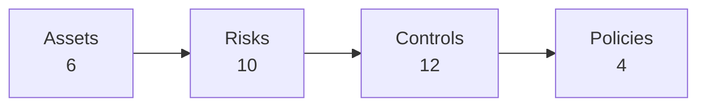

[Overview](README.md) · [Asset Inventory](Asset-Inventory.md) · [Risk Register](Risk-Register.md) · [Access Risks](Access-Risks.md) · [Zero Trust Controls](Zero-Trust-Controls.md) · [Zero Trust Policies](Zero-Trust-Policies.md) · **Traceability Matrix** · [Maturity Metrics](Zero-Trust-Maturity-Metrics.md)

---

# Traceability Matrix
**SecureBank Digital** · Document ID: SBD-ZT-TRC-001 · Version 1.0 · Classification: Internal

## Purpose
End-to-end traceability from protected asset → risk → control → policy, so an auditor or examiner can follow any requirement in either direction.

## Asset → Risk → Control → Policy

| Asset | Risks | Controls | Effectiveness | Policies |
|---|---|---|---|---|
| [A-01](Asset-Inventory.md#a-01) Core Banking Platform (CBP) | [R-02](Risk-Register.md#r-02) 🟠, [AR-04](Access-Risks.md#ar-04) 🔴 | [ZT-05](Zero-Trust-Controls.md#zt-05), [ZT-06](Zero-Trust-Controls.md#zt-06) | ⚪ ⚪ | [POL-ZT-01](Zero-Trust-Policies.md#pol-zt-01), [POL-ZT-03](Zero-Trust-Policies.md#pol-zt-03) |
| [A-02](Asset-Inventory.md#a-02) Customer Accounts Database | [R-02](Risk-Register.md#r-02) 🟠, [AR-03](Access-Risks.md#ar-03) 🟠 | [ZT-07](Zero-Trust-Controls.md#zt-07), [ZT-11](Zero-Trust-Controls.md#zt-11) | 🟡 🟢 | [POL-ZT-01](Zero-Trust-Policies.md#pol-zt-01), [POL-ZT-02](Zero-Trust-Policies.md#pol-zt-02) |
| [A-03](Asset-Inventory.md#a-03) Mobile Banking API Gateway | [R-01](Risk-Register.md#r-01) 🔴, [AR-01](Access-Risks.md#ar-01) 🔴 | [ZT-03](Zero-Trust-Controls.md#zt-03) | 🟡 | [POL-ZT-01](Zero-Trust-Policies.md#pol-zt-01), [POL-ZT-04](Zero-Trust-Policies.md#pol-zt-04) |
| [A-04](Asset-Inventory.md#a-04) Identity Provider (Okta/Entra ID tenant) | [R-03](Risk-Register.md#r-03) 🟡, [AR-02](Access-Risks.md#ar-02) 🟠 | [ZT-01](Zero-Trust-Controls.md#zt-01), [ZT-02](Zero-Trust-Controls.md#zt-02), [ZT-04](Zero-Trust-Controls.md#zt-04), [ZT-12](Zero-Trust-Controls.md#zt-12) | 🟡 🔴 🟡 🟢 | [POL-ZT-01](Zero-Trust-Policies.md#pol-zt-01), [POL-ZT-02](Zero-Trust-Policies.md#pol-zt-02), [POL-ZT-04](Zero-Trust-Policies.md#pol-zt-04) |
| [A-05](Asset-Inventory.md#a-05) Payments Hub Server Cluster | [R-04](Risk-Register.md#r-04) 🟠 | — *(gap — see note)* | — | — |
| [A-06](Asset-Inventory.md#a-06) Employee Laptop Fleet | [R-05](Risk-Register.md#r-05) 🟡, [AR-05](Access-Risks.md#ar-05) 🟡 | [ZT-08](Zero-Trust-Controls.md#zt-08), [ZT-09](Zero-Trust-Controls.md#zt-09), [ZT-10](Zero-Trust-Controls.md#zt-10) | 🔴 ⚪ 🟢 | [POL-ZT-01](Zero-Trust-Policies.md#pol-zt-01), [POL-ZT-02](Zero-Trust-Policies.md#pol-zt-02), [POL-ZT-03](Zero-Trust-Policies.md#pol-zt-03), [POL-ZT-04](Zero-Trust-Policies.md#pol-zt-04) |

## Control → Policy Coverage

| Control | Policies |
|---|---|
| [ZT-01](Zero-Trust-Controls.md#zt-01) | [POL-ZT-01](Zero-Trust-Policies.md#pol-zt-01), [POL-ZT-02](Zero-Trust-Policies.md#pol-zt-02) |
| [ZT-02](Zero-Trust-Controls.md#zt-02) | [POL-ZT-01](Zero-Trust-Policies.md#pol-zt-01), [POL-ZT-02](Zero-Trust-Policies.md#pol-zt-02) |
| [ZT-03](Zero-Trust-Controls.md#zt-03) | [POL-ZT-01](Zero-Trust-Policies.md#pol-zt-01), [POL-ZT-04](Zero-Trust-Policies.md#pol-zt-04) |
| [ZT-04](Zero-Trust-Controls.md#zt-04) | [POL-ZT-01](Zero-Trust-Policies.md#pol-zt-01), [POL-ZT-04](Zero-Trust-Policies.md#pol-zt-04) |
| [ZT-05](Zero-Trust-Controls.md#zt-05) | [POL-ZT-01](Zero-Trust-Policies.md#pol-zt-01), [POL-ZT-03](Zero-Trust-Policies.md#pol-zt-03) |
| [ZT-06](Zero-Trust-Controls.md#zt-06) | [POL-ZT-01](Zero-Trust-Policies.md#pol-zt-01), [POL-ZT-03](Zero-Trust-Policies.md#pol-zt-03) |
| [ZT-07](Zero-Trust-Controls.md#zt-07) | [POL-ZT-01](Zero-Trust-Policies.md#pol-zt-01), [POL-ZT-02](Zero-Trust-Policies.md#pol-zt-02) |
| [ZT-08](Zero-Trust-Controls.md#zt-08) | [POL-ZT-01](Zero-Trust-Policies.md#pol-zt-01), [POL-ZT-02](Zero-Trust-Policies.md#pol-zt-02) |
| [ZT-09](Zero-Trust-Controls.md#zt-09) | [POL-ZT-01](Zero-Trust-Policies.md#pol-zt-01), [POL-ZT-03](Zero-Trust-Policies.md#pol-zt-03) |
| [ZT-10](Zero-Trust-Controls.md#zt-10) | [POL-ZT-01](Zero-Trust-Policies.md#pol-zt-01), [POL-ZT-04](Zero-Trust-Policies.md#pol-zt-04) |
| [ZT-11](Zero-Trust-Controls.md#zt-11) | [POL-ZT-01](Zero-Trust-Policies.md#pol-zt-01), [POL-ZT-02](Zero-Trust-Policies.md#pol-zt-02) |
| [ZT-12](Zero-Trust-Controls.md#zt-12) | [POL-ZT-01](Zero-Trust-Policies.md#pol-zt-01), [POL-ZT-04](Zero-Trust-Policies.md#pol-zt-04) |

## Observations
- **A-05 Payments Hub Server Cluster** has risks but no control directly linked as its primary asset. POL-ZT-03 requires DR segmentation to mirror production; a dedicated control (for example, DR segmentation parity testing and replacement of the legacy VPN path) should be added.
- Every control is governed by at least one policy, and every policy has at least one linked control.
- Critical risks concentrate on identity (customer authentication, privileged access) and network (flat east-west traffic) — matching the controls rated Ineffective or Not Tested, which is where remediation effort should go first.

---

← Previous: [Zero Trust Policies](Zero-Trust-Policies.md) · [↑ Back to Overview](README.md) · Next: [Maturity Metrics](Zero-Trust-Maturity-Metrics.md) →
