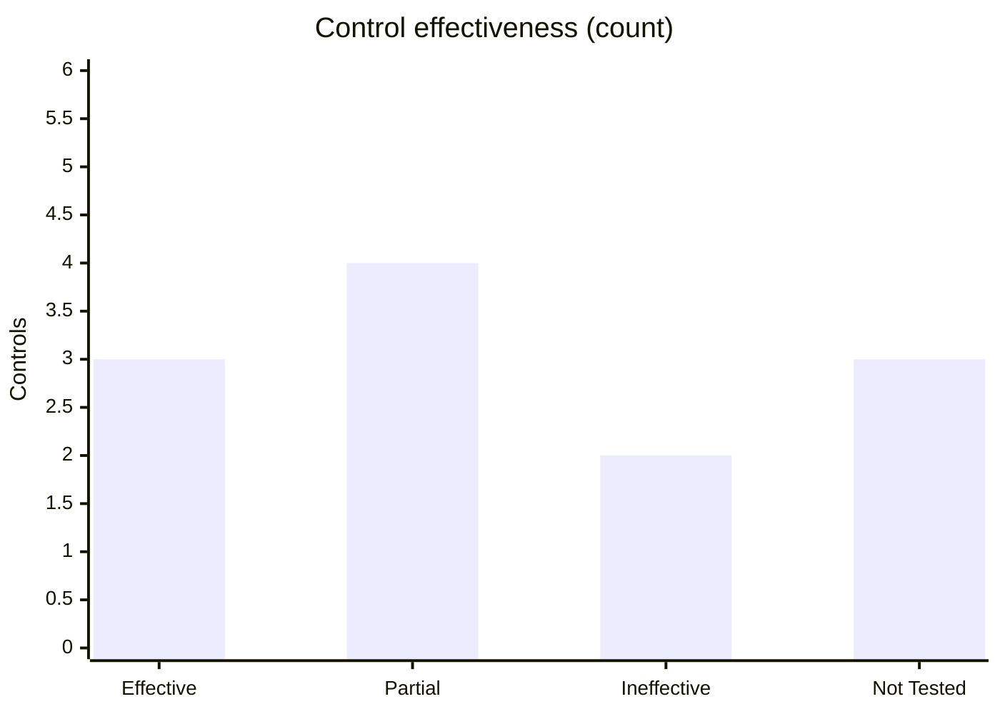

[Overview](README.md) · [Asset Inventory](Asset-Inventory.md) · [Risk Register](Risk-Register.md) · [Access Risks](Access-Risks.md) · [Zero Trust Controls](Zero-Trust-Controls.md) · [Zero Trust Policies](Zero-Trust-Policies.md) · [Traceability Matrix](Traceability-Matrix.md) · **Maturity Metrics**

---

# Zero Trust Maturity Metrics
**SecureBank Digital** · Document ID: SBD-ZT-MET-001 · Version 1.0 · Classification: Internal

## Purpose
Board-level metrics to measure Zero Trust maturity, as required by the programme mandate. Metrics are derived from the controls, risks and policies in this repository and are reported quarterly to the Board Risk Committee (POL-ZT-01, requirement 4).

## Current Position (baseline)

| Metric | Current | Target (12 months) | Source |
|---|---|---|---|
| Controls rated Effective | 3 of 12 (25%) | ≥ 75% | [Controls](Zero-Trust-Controls.md) |
| Weighted control score (Effective = 1, Partial = 0.5) | 42% | ≥ 85% | [Controls](Zero-Trust-Controls.md) |
| Controls Ineffective or Not Tested | 5 | 0 | [Controls](Zero-Trust-Controls.md) |
| Critical risks open | 3 | 0 | [Risks](Risk-Register.md) · [Access](Access-Risks.md) |
| High risks open | 4 | ≤ 2 | [Risks](Risk-Register.md) · [Access](Access-Risks.md) |
| Policies Approved | 2 of 4 | 4 of 4 | [Policies](Zero-Trust-Policies.md) |

## Operational KPIs by Pillar

| Pillar | KPI | Baseline (from control evidence) | Target | Control |
|---|---|---|---|---|
| Identity | Workforce accounts on phishing-resistant MFA | 71% | 100% | [ZT-01](Zero-Trust-Controls.md#zt-01) |
| Identity | Standing privileged admin accounts | 11 | 0 | [ZT-02](Zero-Trust-Controls.md#zt-02) |
| Identity | Median time to deprovision leavers | 19 days | ≤ 4 hours | [ZT-08](Zero-Trust-Controls.md#zt-08) |
| Identity | Customer sessions covered by risk-based auth | iOS only (~54%) | 100% | [ZT-03](Zero-Trust-Controls.md#zt-03) |
| Identity | Critical apps with continuous access evaluation | 14 of 22 | 22 of 22 | [ZT-04](Zero-Trust-Controls.md#zt-04) |
| Devices | Devices meeting compliance baseline | 97% | ≥ 98% | [ZT-10](Zero-Trust-Controls.md#zt-10) |
| Networks | Core banking east-west flows under default-deny | 0% (monitor mode) | 100% | [ZT-05](Zero-Trust-Controls.md#zt-05) |
| Networks | Users accessing apps via ZTNA instead of VPN | 40 of 750 | 750 of 750 | [ZT-09](Zero-Trust-Controls.md#zt-09) |
| Applications & Workloads | Service-to-service calls with mTLS in production | 0% | 100% | [ZT-06](Zero-Trust-Controls.md#zt-06) |
| Data | Services using vaulted, rotated credentials | 1 of 2 | 2 of 2 | [ZT-07](Zero-Trust-Controls.md#zt-07) |
| Visibility & Analytics | Mean time to triage anomalous-access alerts | 18 min | ≤ 30 min | [ZT-12](Zero-Trust-Controls.md#zt-12) |

## Maturity Assessment (CISA Zero Trust Maturity Model v2.0)

| Pillar | Current stage | Evidence | 12-month target |
|---|---|---|---|
| Identity | Initial → Advanced | Phishing-resistant MFA rolling out; risk-based auth partial; privileged access still standing | Advanced |
| Devices | Advanced | Posture-based access enforced and tested | Advanced → Optimal |
| Networks | Traditional → Initial | Flat east-west network; segmentation and ZTNA in pilot | Advanced |
| Applications & Workloads | Initial | Workload identity in development only | Advanced |
| Data | Initial | Vaulted credentials partly deployed | Advanced |
| Visibility & Analytics (cross-cutting) | Advanced | Central logging with UEBA; tested detection | Advanced |
| Governance (cross-cutting) | Initial | 2 of 4 policies approved | Advanced |

## Remediation Priorities
1. **Identity first** — close [ZT-02](Zero-Trust-Controls.md#zt-02) (JIT privileged access) and [ZT-08](Zero-Trust-Controls.md#zt-08) (automated deprovisioning), both Ineffective and tied to Critical/High access risks.
2. **Stop lateral movement** — move [ZT-05](Zero-Trust-Controls.md#zt-05) microsegmentation from monitor to enforce mode for the Core Banking Platform, then extend [ZT-06](Zero-Trust-Controls.md#zt-06) mTLS to production.
3. **Finish customer authentication** — complete Android rollout of [ZT-03](Zero-Trust-Controls.md#zt-03) to meet FFIEC layered-authentication expectations.
4. **Retire the VPN** — scale [ZT-09](Zero-Trust-Controls.md#zt-09) ZTNA and decommission the legacy appliance that also exposes the DR payments path.
5. **Approve the policies** — finalise POL-ZT-02 and POL-ZT-03 so every control has an approved mandate.

## Reporting Cadence
| Audience | Frequency | Content |
|---|---|---|
| Board Risk Committee | Quarterly | Maturity by pillar, Critical/High risk trend, % effective controls |
| Security steering group | Monthly | Pillar KPIs, remediation progress, exceptions |
| Control owners | Continuous | Dashboards from IdP, PAM, segmentation, EDR and SIEM |

---

← Previous: [Traceability Matrix](Traceability-Matrix.md) · [↑ Back to Overview](README.md)
