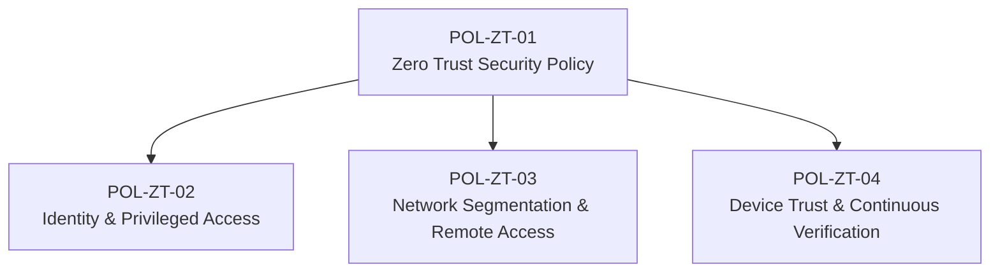

[Overview](README.md) · [Asset Inventory](Asset-Inventory.md) · [Risk Register](Risk-Register.md) · [Access Risks](Access-Risks.md) · [Zero Trust Controls](Zero-Trust-Controls.md) · **Zero Trust Policies** · [Traceability Matrix](Traceability-Matrix.md) · [Maturity Metrics](Zero-Trust-Maturity-Metrics.md)

---

# Zero Trust Policies
**SecureBank Digital** · Document ID: SBD-ZT-POL-001 · Version 1.0 · Classification: Internal

## Purpose
The policy layer that mandates the Zero Trust controls. One overarching policy sets the model; three domain policies set enforceable requirements for identity, network and device/session trust.

## Policy Summary

| ID | Title | Status | Owner | Approver | Effective | Review Date |
|---|---|---|---|---|---|---|
| [POL-ZT-01](#pol-zt-01) | Zero Trust Security Policy | 🟢 Approved | Chief Information Security Officer | Board Risk Committee | 2026-10-15 | 2027-10-15 |
| [POL-ZT-02](#pol-zt-02) | Identity and Privileged Access Management Policy | 🟡 Under Review | IAM Manager | Chief Information Security Officer | Pending approval | 2027-04-30 |
| [POL-ZT-03](#pol-zt-03) | Network Segmentation and Remote Access Policy | ⚪ Draft | Network Security Architect | Chief Information Security Officer | Pending approval | 2027-01-31 |
| [POL-ZT-04](#pol-zt-04) | Device Trust and Continuous Verification Policy | 🟢 Approved | IT Operations Manager | Chief Information Security Officer | 2026-09-30 | 2027-09-30 |

## Policy Hierarchy

## Policy Details

### POL-ZT-01
**Zero Trust Security Policy**

| Field | Value |
|---|---|
| Status | 🟢 Approved |
| Owner | Chief Information Security Officer |
| Approver | Board Risk Committee |
| Effective date | 2026-10-15 |
| Review date | 2027-10-15 |
| Framework alignment | NIST SP 800-207 tenets; NIST CSF 2.0 GV.PO-01; ISO 27001 A.5.1 |
| Linked controls | [ZT-01](Zero-Trust-Controls.md#zt-01), [ZT-02](Zero-Trust-Controls.md#zt-02), [ZT-03](Zero-Trust-Controls.md#zt-03), [ZT-04](Zero-Trust-Controls.md#zt-04), [ZT-05](Zero-Trust-Controls.md#zt-05), [ZT-06](Zero-Trust-Controls.md#zt-06), [ZT-07](Zero-Trust-Controls.md#zt-07), [ZT-08](Zero-Trust-Controls.md#zt-08), [ZT-09](Zero-Trust-Controls.md#zt-09), [ZT-10](Zero-Trust-Controls.md#zt-10), [ZT-11](Zero-Trust-Controls.md#zt-11), [ZT-12](Zero-Trust-Controls.md#zt-12) |

**Purpose.** Establishes Zero Trust as SecureBank's security model: no implicit trust based on network location, and every access request is verified explicitly, granted with least privilege and continuously evaluated.

**Key requirements**

1. All access to resources is authenticated, authorised and encrypted per session, regardless of network location.
2. Access decisions are made by a central policy decision point (PDP) using identity, device posture and risk signals.
3. Critical assets (core banking, customer data, IdP) are defined as protect surfaces with documented transaction flows.
4. Zero Trust maturity is measured quarterly against the CISA ZTMM and reported to the Board Risk Committee.
5. Exceptions require CISO approval, compensating controls and a 90-day maximum term.

### POL-ZT-02
**Identity and Privileged Access Management Policy**

| Field | Value |
|---|---|
| Status | 🟡 Under Review |
| Owner | IAM Manager |
| Approver | Chief Information Security Officer |
| Effective date | Pending approval |
| Review date | 2027-04-30 |
| Framework alignment | NIST CSF PR.AA-01 to PR.AA-05; CIS Controls 5 & 6; PCI DSS 7, 8; FFIEC authentication guidance |
| Linked controls | [ZT-01](Zero-Trust-Controls.md#zt-01), [ZT-02](Zero-Trust-Controls.md#zt-02), [ZT-07](Zero-Trust-Controls.md#zt-07), [ZT-08](Zero-Trust-Controls.md#zt-08), [ZT-11](Zero-Trust-Controls.md#zt-11) |

**Purpose.** Defines how workforce, customer and machine identities are created, authenticated, authorised and removed, including controls over privileged access.

**Key requirements**

1. Workforce accounts must use phishing-resistant MFA (FIDO2/passkeys); SMS and push factors are prohibited.
2. No standing privileged access: admin rights are granted just-in-time through PAM with approval, a 4-hour maximum and session recording.
3. Admins use dedicated admin identities separate from daily-use accounts.
4. Leavers' access is removed within 4 hours of HRIS termination.
5. Privileged and critical-system access is recertified quarterly.
6. Service accounts use vaulted, automatically rotated credentials scoped to least privilege.

### POL-ZT-03
**Network Segmentation and Remote Access Policy**

| Field | Value |
|---|---|
| Status | ⚪ Draft |
| Owner | Network Security Architect |
| Approver | Chief Information Security Officer |
| Effective date | Pending approval |
| Review date | 2027-01-31 |
| Framework alignment | NIST CSF PR.IR-01, PR.DS-02; CIS Controls 12.2, 13.4, 13.5; PCI DSS 1.2–1.4 |
| Linked controls | [ZT-05](Zero-Trust-Controls.md#zt-05), [ZT-06](Zero-Trust-Controls.md#zt-06), [ZT-09](Zero-Trust-Controls.md#zt-09) |

**Purpose.** Replaces perimeter-based trust with microsegmentation and application-level remote access, limiting lateral movement to critical banking systems.

**Key requirements**

1. Core banking, payments and customer-data workloads sit in dedicated segments with default-deny east-west policies.
2. Only documented, owner-approved application flows are permitted; new flows require change approval.
3. Service-to-service communication uses workload identity and mutual TLS.
4. Remote access is via ZTNA to named applications only; network-level VPN access is retired by the end of FY27.
5. Segmentation policies are tested at least quarterly with simulated lateral-movement attempts.
6. DR environments mirror production segmentation and access policies.

### POL-ZT-04
**Device Trust and Continuous Verification Policy**

| Field | Value |
|---|---|
| Status | 🟢 Approved |
| Owner | IT Operations Manager |
| Approver | Chief Information Security Officer |
| Effective date | 2026-09-30 |
| Review date | 2027-09-30 |
| Framework alignment | NIST CSF DE.CM-03, DE.CM-09; CIS Controls 4, 8, 10; FFIEC authentication guidance |
| Linked controls | [ZT-03](Zero-Trust-Controls.md#zt-03), [ZT-04](Zero-Trust-Controls.md#zt-04), [ZT-10](Zero-Trust-Controls.md#zt-10), [ZT-12](Zero-Trust-Controls.md#zt-12) |

**Purpose.** Requires devices and sessions to prove their trustworthiness continuously, so that access is revoked promptly when risk changes.

**Key requirements**

1. Only managed devices meeting the compliance baseline (healthy EDR, OS patched within 14 days, full-disk encryption) may access sensitive applications.
2. Session tokens for critical applications have a maximum lifetime of 60 minutes and are revoked within 5 minutes on a risk event.
3. Customer mobile sessions are risk-scored, with step-up verification for new payees and transfers over $2,500.
4. Authentication, PAM and policy-decision logs are sent to the SIEM and retained for 12 months.
5. The SOC triages anomalous-access alerts within 30 minutes.

> Review cycle: annual for Approved policies; Draft and Under Review policies carry target approval or review dates.

---

← Previous: [Zero Trust Controls](Zero-Trust-Controls.md) · [↑ Back to Overview](README.md) · Next: [Traceability Matrix](Traceability-Matrix.md) →
